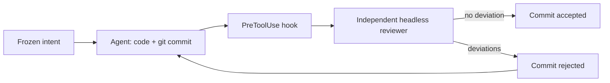

# Kaldor

> An intent/code review guard for Claude Code: no agent commit enters the repository without being checked against a declared intent, by a reviewer the agent does not control.

[](https://github.com/Atypical-Consulting/kaldor/actions/workflows/ci.yml)
[](https://www.nuget.org/packages/Atypical.Kaldor)

**Documentation: [atypical-consulting.github.io/kaldor](https://atypical-consulting.github.io/kaldor/)**

## The idea

With agents that code fast, reading every line no longer scales, and a review done by the same agent only validates its own reasoning. Kaldor moves the review to the intent:

1. **Before the code**, the agent writes a short intent (`.kaldor/intent.md`) that you approve; it is frozen by hash.
2. **At commit time**, a Claude Code hook launches an independent reviewer (`claude -p`, fixed prompt, no tools, no CLAUDE.md) that checks the staged diff against the intent and the project rules.
3. **Deviation found**: the commit is rejected and the agent fixes it. **No deviation**: the commit goes through.
4. **You** read an intent-level report and a few sensitive hunks, instead of the full diff.



The idea is inspired by Antique, the internal review tool described by Anthropic in [Redesigning source control at Anthropic](https://www.anthropic.com/engineering/redesigning-source-control).

## Install

Requirements: [.NET 10 SDK](https://dotnet.microsoft.com/download) (for `dnx`), Claude Code v2.1.295 or later, git.

**Once per machine**, in Claude Code:

```text
/plugin install kaldor --marketplace Atypical-Consulting/kaldor
```

The plugin brings the hooks, the intent skill and a `kaldor` command for the agent. The .NET tool itself is never installed: the hooks run it through `dnx`, which fetches the pinned version from NuGet on first use.

**Once per repository**, from your terminal:

```bash
dnx Atypical.Kaldor init     # creates .kaldor/rules.json and a git pre-commit hook
git add .kaldor && git commit -m "chore: enable Kaldor"
```

Make this commit yourself, not through Claude. Kaldor refuses Claude's commits until a task intent is frozen and confirmed, so enabling Kaldor, like any later change to the rules, stays your decision.

Prefer typing `kaldor`? `dotnet tool install -g Atypical.Kaldor`. The examples below use that short form.

## Day to day

Work with Claude Code as usual. Kaldor steps in twice:

- **Before the first edit** of a task, Claude writes `.kaldor/intent.md`, shows it to you, then freezes it with `kaldor intent freeze`. Edits are refused until then.
- **Confirm the intent** with `dnx Atypical.Kaldor intent confirm` (or `kaldor intent confirm` with the global tool) in a terminal outside Claude Code, any time before Claude's first commit. Claude froze it; only you can vouch for it, so commits wait for your confirmation.
- **At each commit**, the reviewer runs (a few seconds). Accepted commits go through; rejected ones come back to Claude with the list of deviations.

Your commands, from a terminal outside Claude Code (the `!` prefix has no terminal, and the confirmations below need one). Without the global tool, type `dnx Atypical.Kaldor` instead of `kaldor`:

| Command | What it does |
| --- | --- |
| `kaldor report [count]` | The latest reviews from every worktree: intent, deviations, hunks worth reading |
| `kaldor intent confirm` | Confirm the intent Claude froze; its commits wait for it |
| `kaldor intent confirm --all` | Confirm every draft in `.kaldor/queue/` up front, for sessions that cover several tasks; each is used once when a task freezes exactly that text |
| `kaldor approve` | Force the staged diff through when you disagree with the reviewer |
| `kaldor intent amend --accept` | Accept a change to the intent that Claude proposed |
| `kaldor review` | Dry-run review of the staged diff, nothing recorded |
| `kaldor doctor` | Check the installation |

`intent confirm`, `approve` and `amend --accept` are refused to the agent twice over: the hook denies them, and they refuse to run inside a Claude Code session (`CLAUDECODE=1`) or without an interactive terminal.

```text
2026-10-17 23:30  review          BLOCKED
  deviation  README.md: modified despite the intent saying it must not be touched.
  deviation  greet.py: adds a network call to http://example.com/track that sends the user's name.
  to read    greet.py (logic)
  summary    The diff adds an undeclared tracking request in greet.py and edits README.md, which the intent forbids.
```

## Rules

`.kaldor/rules.json` is versioned with the repository:

```json
{
  "sensitive": ["**/Auth/**", "**/Migrations/**", "**/appsettings*.json", ".github/**"],
  "trivial": ["**/*.md"],
  "reviewer_model": "sonnet",
  "block_on": ["scope_creep", "sensitive_change", "weakened_tests", "contradicts_intent"]
}
```

**Unattended sessions.** Set `"confirm": "after"` in `.kaldor/rules.json` (the default is `"before"`) when nobody can run `kaldor intent confirm` during a session, for example under `auto-dev`. Commits on an unconfirmed intent then go to the independent reviewer instead of being refused, and each review is logged as unconfirmed. The review is kept; what moves to after the session is your check that the intent itself was right: `kaldor report --unconfirmed` lists those reviews. Only you can set it: the gate applies the rules committed at `HEAD`, so an edit to `.kaldor/rules.json` (by any command) takes effect once committed, and a commit that changes `.kaldor/` needs your `kaldor approve`. A change committed on a branch takes effect when that branch is checked out. Once the rules have been committed, the repository stays guarded on every branch: Kaldor writes `.git/kaldor/guarded`, and on a commit with no `.kaldor/rules.json` (an orphan branch, an old commit) the default rules apply, never a work-tree file. To turn Kaldor off, remove `.git/kaldor/guarded` yourself and commit the removal of `.kaldor/` (with `kaldor approve`).

`.kaldor/intent.md` is local and ignored by git. The verdicts, the frozen intent hash and the history live in the git directory (`.git/kaldor/`, one folder per worktree), so `git clean` and `git worktree remove` leave them alone and `kaldor report` shows every worktree. The agent can write `intent.md` only before the intent is frozen; its edit tools and the shell writes the gate recognises (redirections, `tee`, `cp`, `mv`, `rm`, `sed -i`, `Set-Content`…) are refused on everything else in `.kaldor/` and `.git/kaldor/`.

## What it guards against

The target is a hurried agent taking a shortcut, not a hostile one. Each shortcut below is a test in `tests/Kaldor.Tests/BypassTests.cs`:

| Shortcut | Why it fails |
| --- | --- |
| Framing the reviewer | The hook launches the reviewer with a fixed prompt; the agent never writes a word of it |
| Writing its own verdict | The verdict is produced inside the hook's process; the state in `.git/kaldor/` is closed to the agent's edits and shell writes, and the rules are read from `HEAD`, so changing them needs a commit that only your `kaldor approve` lets through |
| Freezing an intent you never saw | Commits wait until you run `kaldor intent confirm` |
| Rewriting the intent | Frozen by hash; changes go through an amendment only you can accept |
| Changing code after review | Verdicts are bound to the hash of the staged diff |
| `git -C`, `cd x &&`, `bash -c`, aliases | The hook parses the command line itself |
| Committing from a script | The git pre-commit hook runs the same check for any commit made with `git commit` inside Claude Code; other ways of making a commit are covered by the history check below |
| `git cherry-pick`, `revert`, `am`, `rebase`, `merge`, `commit-tree` + `update-ref` | Not refused, but checked afterwards: at the next commit or push through the Bash tool, a commit on `HEAD` with no recorded review (matched by `git patch-id`) is refused until you run `kaldor approve`. Commits from remote-tracking branches, rebased reviewed commits and clean merges pass |
| `--no-verify`, `core.hooksPath` (also set with `git config`), `GIT_*` variables, `--git-dir`, `--work-tree` or `--index-file` on a commit | Refused: the command is refused, and so is any commit while git would not run Kaldor's `pre-commit` hook (rerun `kaldor init`) |
| Hiding the change from the reviewer (textconv, `-diff` or `binary` attributes, `core.attributesFile`, `core.fsmonitor`) | Kaldor's own git calls ignore these: the reviewer gets the staged change as text (a file that really holds NUL bytes stays `Binary files differ`) |
| Breaking the hook | `onFailure: "block"`: a failing or timed-out hook blocks |

### Known limits

- A script or an interpreter can still set `GIT_*` variables or git settings for its own commits: the gate only sees the command line.
- An agent that stashes its work gets a clean tree back and can freeze a new intent, but its commits then wait for your `kaldor intent confirm`.
- A write from inside a script or an interpreter (`python -c`) can still reach `.git/kaldor/state.json` and forge a pass: the gate only sees the command line.
- Code the agent writes and runs (a script, `python -c`) can clear `CLAUDECODE` and run a human-only command in a pseudo-terminal, as it can write `.git/kaldor/state.json`: the gate only sees the command line (so does a command that starts a clean environment, such as `ssh`, `docker run`, `systemctl --user` or `sudo -u`). A terminal you start from inside a Claude Code session inherits the variable and is refused too.
- An unreviewed commit is caught at the next commit or push through the Bash tool, not when it is made. A push from a script, a write to remote-tracking refs (`git update-ref refs/remotes/...`, or `git fetch . HEAD:refs/remotes/...`) are out of reach. Only the history that exists when Kaldor first runs on a repository (`kaldor init`, or its first hook call) is trusted; every worktree then checks its commits against one reviewed set in `.git/kaldor/reviewed.json`.
- An interpreter can delete `.git/kaldor/guarded` (or `state.json`), like any write to `.git/kaldor/` that is not an edit tool or a recognised shell write (#9). Without the marker, a checkout without the rules is only guarded if some branch tip still has them.
- A push checks every local branch and tag, whatever it sends: an old unreviewed commit on any branch blocks a push until you `kaldor approve` it (a push of a raw commit id is refused). Commits reviewed in one worktree are accepted in all of them. A rebase that changes a commit's context lines, or resolves a conflict, needs your `kaldor approve`.
- A staged diff over 600,000 characters is refused outright: split the commit.
- When the reviewer fails or returns no verdict, the commit is blocked and the next attempt reviews again.

Known costs: about 0.5 s of `dnx` startup on each Bash or edit tool call, and one reviewer call (a few seconds, a few cents) per distinct staged diff.

## Documentation

- [Documentation site](https://atypical-consulting.github.io/kaldor/): how it works, install, commands, rules, threat model, costs.
- [Project dossier](docs/project-dossier.md): scope, architecture, commands, file contracts, requirements, tests, threats, roadmap.
- [Architecture analysis](docs/architecture-analysis.md): each building block checked against the Claude Code documentation, identified flaws and comparison of the variants.

## Development

```bash
dotnet test                       # parser and bypass suites, with a fake reviewer
claude plugin validate ./plugin
```

Releases are cut by [release-please](https://github.com/googleapis/release-please) from Conventional Commit PR titles and published to NuGet with trusted publishing.

## License

[MIT](LICENSE) © 2026 Atypical Consulting
