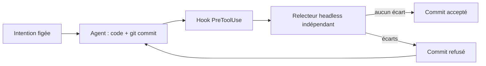

# Kaldor

> Une garde de revue intention/code pour Claude Code : aucun commit d'agent n'entre dans le dépôt sans avoir été confronté à une intention déclarée, par un relecteur que l'agent ne contrôle pas.

**Statut : conception.** Aucun code publié pour l'instant ; ce dépôt contient l'analyse et le dossier de projet.

## Le principe

Avec des agents qui codent vite, relire chaque ligne ne tient plus, et une revue faite par le même agent valide son propre raisonnement. Kaldor déplace la revue vers l'intention :

1. **Avant le code**, l'agent rédige une intention courte (`.kaldor/intent.md`) que tu valides ; elle est figée par hash.
2. **Au commit**, un hook Claude Code lance un relecteur indépendant, avec un prompt figé, qui confronte le diff à l'intention et aux règles du projet.
3. **Écart trouvé** : le commit est refusé et l'agent corrige. **Aucun écart** : le commit passe.
4. **Toi**, tu lis un rapport au niveau intention et quelques hunks sensibles, au lieu du diff complet.



L'idée s'inspire d'Antique, l'outil de revue interne décrit par Anthropic dans [Redesigning source control at Anthropic](https://www.anthropic.com/engineering/redesigning-source-control).

## Utilisation prévue

```bash
# Une fois par machine : installer le plugin Kaldor dans Claude Code.
# L'outil .NET est lancé par les hooks via dnx, sans installation.

# Une fois par dépôt
dnx Atypical.Kaldor init

# Au quotidien
dnx Atypical.Kaldor report     # ce qui mérite ta lecture
dnx Atypical.Kaldor approve    # forcer un commit refusé (humain uniquement)
```

## Documentation

- [Dossier de projet](docs/dossier-de-projet.md) : nom, périmètre, architecture, utilisation, commandes, contrats de fichiers, exigences, tests, menaces, feuille de route.
- [Analyse d'architecture](docs/analyse-architecture.md) : vérification de chaque brique contre la documentation Claude Code, failles identifiées et comparaison des variantes.

## Prérequis visés

- SDK .NET 10 (pour `dnx`)
- Claude Code v2.1.295 ou plus récent (`onFailure` sur les hooks)
- git

## Licence

[MIT](LICENSE) © 2026 Atypical Consulting
