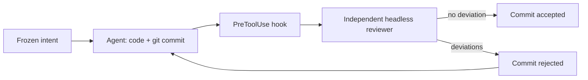

# Kaldor

> An intent/code review guard for Claude Code: no agent commit enters the repository without being checked against a declared intent, by a reviewer the agent does not control.

[](https://github.com/Atypical-Consulting/kaldor/actions/workflows/ci.yml)
[](https://www.nuget.org/packages/Atypical.Kaldor)

**Documentation: [atypical-consulting.github.io/kaldor](https://atypical-consulting.github.io/kaldor/)**

## The idea

With agents that code fast, reading every line no longer scales, and a review done by the same agent only validates its own reasoning. Kaldor moves the review to the intent:

1. **Before the code**, the agent writes a short intent (`.kaldor/intent.md`) that you approve; it is frozen by hash.
2. **At commit time**, a Claude Code hook launches an independent reviewer (`claude -p`, fixed prompt, no tools, no CLAUDE.md) that checks the staged diff against the intent and the project rules.
3. **Deviation found**: the commit is rejected and the agent fixes it. **No deviation**: the commit goes through.
4. **You** read an intent-level report and a few sensitive hunks, instead of the full diff.



The idea is inspired by Antique, the internal review tool described by Anthropic in [Redesigning source control at Anthropic](https://www.anthropic.com/engineering/redesigning-source-control).

## Install

Requirements: [.NET 10 SDK](https://dotnet.microsoft.com/download) (for `dnx`), Claude Code v2.1.295 or later, git.

**Once per machine**, in Claude Code:

```text
/plugin install kaldor --marketplace Atypical-Consulting/kaldor
```

The plugin brings the hooks, the intent skill and a `kaldor` command for the agent. The .NET tool itself is never installed: the hooks run it through `dnx`, which fetches the pinned version from NuGet on first use.

**Once per repository**, from your terminal:

```bash
dnx Atypical.Kaldor init     # creates .kaldor/rules.json and a git pre-commit hook
git add .kaldor && git commit -m "chore: enable Kaldor"
```

Prefer typing `kaldor`? `dotnet tool install -g Atypical.Kaldor`. The examples below use that short form.

## Day to day

Work with Claude Code as usual. Kaldor steps in twice:

- **Before the first edit** of a task, Claude writes `.kaldor/intent.md`, shows it to you, then freezes it with `kaldor intent freeze`. Edits are refused until then.
- **At each commit**, the reviewer runs (a few seconds). Accepted commits go through; rejected ones come back to Claude with the list of deviations.

Your commands, from your own terminal:

| Command | What it does |
| --- | --- |
| `kaldor report [count]` | The latest reviews: intent, deviations, hunks worth reading |
| `kaldor approve` | Force the staged diff through when you disagree with the reviewer |
| `kaldor intent amend --accept` | Accept a change to the intent that Claude proposed |
| `kaldor review` | Dry-run review of the staged diff, nothing recorded |
| `kaldor doctor` | Check the installation |

`approve` and `amend --accept` are refused to the agent twice over: the hook denies them, and they need an interactive terminal.

```text
2026-10-17 23:30  review          BLOCKED
  deviation  README.md: modified despite the intent saying it must not be touched.
  deviation  greet.py: adds a network call to http://example.com/track that sends the user's name.
  to read    greet.py (logic)
  summary    The diff adds an undeclared tracking request in greet.py and edits README.md, which the intent forbids.
```

## Rules

`.kaldor/rules.json` is versioned with the repository:

```json
{
  "sensitive": ["**/Auth/**", "**/Migrations/**", "**/appsettings*.json", ".github/**"],
  "trivial": ["**/*.md"],
  "reviewer_model": "sonnet",
  "block_on": ["scope_creep", "sensitive_change", "weakened_tests", "contradicts_intent"]
}
```

Everything else in `.kaldor/` (intent, verdicts, history) is local and ignored by git. The agent cannot write there except to `intent.md`, and only before the intent is frozen.

## What it guards against

The target is a hurried agent taking a shortcut, not a hostile one. Each shortcut below is a test in `tests/Kaldor.Tests/BypassTests.cs`:

| Shortcut | Why it fails |
| --- | --- |
| Framing the reviewer | The hook launches the reviewer with a fixed prompt; the agent never writes a word of it |
| Writing its own verdict | The verdict is produced inside the hook's process; `.kaldor/` is closed to the agent |
| Rewriting the intent | Frozen by hash; changes go through an amendment only you can accept |
| Changing code after review | Verdicts are bound to the hash of the staged diff |
| `git -C`, `cd x &&`, `bash -c`, aliases | The hook parses the command line itself |
| Committing from a script | The git pre-commit hook runs the same check for any commit made inside Claude Code |
| `--no-verify`, `core.hooksPath` | Refused |
| Breaking the hook | `onFailure: "block"`: a failing or timed-out hook blocks |

Known costs: about 0.5 s of `dnx` startup on each Bash or edit tool call, and one reviewer call (a few seconds, a few cents) per distinct staged diff.

## Documentation

- [Documentation site](https://atypical-consulting.github.io/kaldor/): how it works, install, commands, rules, threat model, costs.
- [Project dossier](docs/project-dossier.md): scope, architecture, commands, file contracts, requirements, tests, threats, roadmap.
- [Architecture analysis](docs/architecture-analysis.md): each building block checked against the Claude Code documentation, identified flaws and comparison of the variants.

## Development

```bash
dotnet test                       # parser and bypass suites, with a fake reviewer
claude plugin validate ./plugin
```

Releases are cut by [release-please](https://github.com/googleapis/release-please) from Conventional Commit PR titles and published to NuGet with trusted publishing.

## License

[MIT](LICENSE) © 2026 Atypical Consulting
