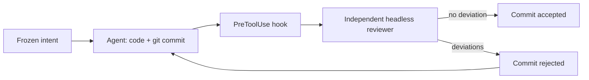

# Kaldor

> An intent/code review guard for Claude Code: no agent commit enters the repository without being checked against a declared intent, by a reviewer the agent does not control.

**Status: design.** No code published yet; this repository contains the analysis and the project dossier.

## The idea

With agents that code fast, reading every line no longer scales, and a review done by the same agent only validates its own reasoning. Kaldor moves the review to the intent:

1. **Before the code**, the agent writes a short intent (`.kaldor/intent.md`) that you approve; it is frozen by hash.
2. **At commit time**, a Claude Code hook launches an independent reviewer, with a fixed prompt, that checks the diff against the intent and the project rules.
3. **Deviation found**: the commit is rejected and the agent fixes it. **No deviation**: the commit goes through.
4. **You** read an intent-level report and a few sensitive hunks, instead of the full diff.



The idea is inspired by Antique, the internal review tool described by Anthropic in [Redesigning source control at Anthropic](https://www.anthropic.com/engineering/redesigning-source-control).

## Planned usage

```bash
# Once per machine: install the Kaldor plugin in Claude Code.
# The .NET tool is launched by the hooks via dnx, no installation needed.

# Once per repository
dnx Atypical.Kaldor init

# Day to day
dnx Atypical.Kaldor report     # what deserves your reading
dnx Atypical.Kaldor approve    # force a rejected commit through (humans only)
```

## Documentation

- [Project dossier](docs/project-dossier.md): name, scope, architecture, usage, commands, file contracts, requirements, tests, threats, roadmap.
- [Architecture analysis](docs/architecture-analysis.md): each building block checked against the Claude Code documentation, identified flaws and comparison of the variants.

## Target prerequisites

- .NET 10 SDK (for `dnx`)
- Claude Code v2.1.295 or later (`onFailure` on hooks)
- git

## License

[MIT](LICENSE) © 2026 Atypical Consulting
