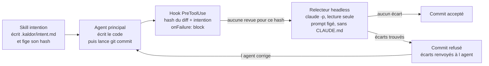

# Kaldor : analyse d'architecture

17 octobre 2026 · Philippe Matray, Atypical Consulting

## Synthèse et verdict

L'architecture est faisable avec les briques actuelles de Claude Code, mais pas telle que formulée : la variante « hook qui exige un rapport écrit par un sous-agent » a deux failles réelles, et une variante plus simple les ferme.

- **Ce qui tient** : un hook `PreToolUse` peut bloquer un `git commit` (exit 2 ou `permissionDecision: deny`) et renvoyer à Claude la raison du blocage. Un sous-agent démarre bien avec un contexte vierge et des outils restreints.
- **Faille 1, le biais de cadrage** : la doc confirme que c'est l'agent principal qui rédige le message de délégation du sous-agent. Le contexte est vierge, mais le prompt ne l'est pas.
- **Faille 2, le rapport falsifiable** : si le hook se contente de vérifier qu'un fichier de verdict existe, l'agent principal peut l'écrire lui-même, par paresse plus que par malice.
- **Faille 3, le filtre `if` n'est pas une barrière** : la doc le qualifie de best-effort et renvoie au système de permissions pour une interdiction stricte. Le script doit analyser la commande lui-même.

Verdict : faire lancer la relecture **par le hook lui-même** (Claude headless ou hook de type `agent`), pas par l'agent principal. Le verdict n'existe alors que dans le processus du hook, et l'agent principal n'a aucune prise sur le prompt du relecteur.

## Architecture cible

L'agent principal code et committe, mais c'est le hook qui déclenche la relecture et détient le verdict.

Le relecteur ne voit que l'intention figée et le diff, jamais le récit de l'agent principal. Toute modification après revue change le hash et relance une relecture.

## Vérification brique par brique

Chaque hypothèse de départ a été confrontée à la documentation officielle des [hooks](https://code.claude.com/docs/en/hooks) et des [sous-agents](https://code.claude.com/docs/en/sub-agents) de Claude Code.

| Hypothèse | Statut | Ce que dit la doc |
| --- | --- | --- |
| Un hook peut bloquer un commit | Confirmé | `PreToolUse` sur `Bash`, exit 2 ou `permissionDecision: deny`. La raison (stderr) est montrée à Claude. |
| Le hook peut cibler `git commit` | Partiel | Le champ `if: "Bash(git commit *)"` existe, mais il est best-effort. Il ne reconnaît pas `git -C x commit`, un alias ou un script. |
| Un hook en panne bloque | Non par défaut | Un hook qui plante ou dépasse son timeout laisse passer l'action. Il faut `onFailure: "block"` (Claude Code v2.1.295+). |
| Le sous-agent a un contexte frais | Confirmé, avec réserve | Pas d'historique de conversation, mais il reçoit le message de délégation écrit par l'agent principal, plus les CLAUDE.md (désactivables via `omitClaudeMd`). |
| Le sous-agent peut être en lecture seule | Confirmé | `tools: Read, Grep, Glob, Bash` ou `disallowedTools: Write, Edit`. |
| Les hooks tournent aussi dans les sous-agents | Confirmé | Avec `agent_id` et `agent_type` dans l'entrée JSON, ce qui permet de distinguer le relecteur. |
| Un hook peut lancer lui-même un relecteur | Confirmé | Deux voies : un hook `command` qui appelle `claude -p`, ou un hook de type `agent` (expérimental, outils Read/Grep/Glob, timeout 60 s par défaut). |
| Timeout suffisant pour une revue | Confirmé | 600 s par défaut pour un hook `command`, réglable via `timeout`. |
| Windows supporté | Confirmé, avec réglages | Matcher `Bash\|PowerShell`, `shell: "powershell"`, et forme exec (`command` + `args`) recommandée. |

Point non vérifié : la doc ne précise pas si un hook `agent` peut exécuter `git diff`. Il faudra un POC, ou lui fournir le diff dans un fichier.

## Failles identifiées et parades

Le modèle de menace est un agent pressé qui prend un raccourci, pas un agent hostile. Sur une machine locale, rien n'est inviolable : le but est que le chemin honnête soit le plus court.

| Faille | Gravité | Parade |
| --- | --- | --- |
| Biais de cadrage du sous-agent | Haute | Le relecteur lit l'intention et le diff depuis le disque. Mieux : c'est le hook qui le lance, avec un prompt figé. |
| Rapport de revue écrit par l'agent principal | Haute | Pas de fichier de verdict à croire : le hook produit le verdict lui-même. À défaut, refuser les écritures dans `.kaldor/` quand `agent_type` n'est pas le relecteur. |
| Intention réécrite après coup pour coller au code | Moyenne | Hacher `intent.md` au premier `Edit`/`Write` de la tâche et refuser le commit si le hash a changé sans ton accord. |
| Contournement du filtre `if` (`git -C`, alias, script) | Moyenne | Pas de `if`, ou un `if` large (`Bash(git *)`), et analyse de la commande dans le script. Compléter par une règle de permission si besoin. |
| Hook en panne qui laisse passer | Haute | `onFailure: "block"` sur le hook de commit. |
| Relecture périmée après une modification | Moyenne | Verdict lié au hash de `git diff --cached` plus le hash de l'intention. Tout changement invalide la revue. |
| Récursion du relecteur headless | Faible | Le relecteur ne committe pas, mais poser une variable d'environnement (ex. `REVIEW_RUNNING=1`) que le hook vérifie en entrée. |
| Commit fait à la main dans le terminal | Faible | Hors périmètre assumé. Si besoin, un hook git `pre-commit` qui appelle le même script couvre ce cas. |

## Comparaison des variantes de relecture

La variante B est la seule qui ferme à la fois le biais de cadrage et la falsification, au prix d'un commit plus lent.

| Critère | A. Sous-agent lancé par l'agent principal | B. Hook `command` qui lance `claude -p` | C. Hook de type `agent` |
| --- | --- | --- | --- |
| Indépendance du prompt | Faible : l'agent rédige la délégation | Totale : prompt figé dans le script | Totale : prompt figé dans la config |
| Verdict falsifiable | Oui, via le fichier de rapport | Non, verdict dans le processus du hook | Non |
| Accès au diff | Oui (Bash) | Oui, le script le calcule et le passe | Incertain, à tester |
| Maturité | Stable | Stable | Expérimental, peut changer |
| Latence par commit | Revue visible dans la session | Plus lente, revue en coulisse | Plus lente, timeout 60 s par défaut |
| Coût | Inclus dans la session | Une session headless par commit | Un appel modèle par commit |
| Effort de mise en place | Faible | Moyen (script, garde de récursion) | Faible, si le diff est accessible |

La variante A reste utile en complément : un skill peut lancer la revue en amont pour corriger tôt, la variante B servant de barrière finale.

## Recommandation et prochaines étapes

Partir sur la variante B comme barrière, avec le skill en amont, et tester la variante C en parallèle pour la remplacer si elle tient.

1. **POC du hook de commit** : script qui détecte un commit dans la commande, calcule le hash du diff stagé et de l'intention, refuse sans relecture. `onFailure: "block"`, timeout 900 s.
2. **Relecteur headless** : `claude -p` avec une définition d'agent en lecture seule, `omitClaudeMd: true`, prompt figé, sortie JSON (verdict, écarts, hunks à relire).
3. **Skill intention** : écrit `.kaldor/intent.md` avant tout code et fige son hash.
4. **Fichier de règles** : chemins sensibles et catégories de risque par projet.
5. **Test de contournement** : `git -C`, commit dans un script, modification après revue, intention réécrite. Chaque cas doit être bloqué.
6. **POC variante C** : vérifier si un hook `agent` peut lire le diff, et mesurer sa latence.

Questions ouvertes :

- Quel modèle pour le relecteur ? Un modèle plus léger réduit le coût, mais la valeur est dans la détection des écarts subtils.
- Plateforme cible du premier POC : macOS (bash) ou Windows (PowerShell) ?
