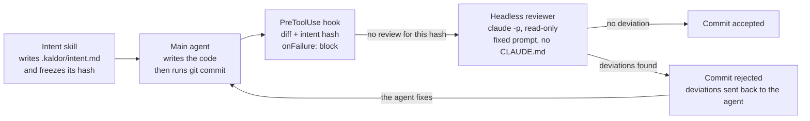

# Kaldor: architecture analysis

October 17, 2026 · Philippe Matray, Atypical Consulting

## Summary and verdict

The architecture is feasible with Claude Code's current building blocks, but not as originally formulated: the "hook that requires a report written by a subagent" variant has two real flaws, and a simpler variant closes them.

- **What holds**: a `PreToolUse` hook can block a `git commit` (exit 2 or `permissionDecision: deny`) and send the blocking reason back to Claude. A subagent does start with a blank context and restricted tools.
- **Flaw 1, framing bias**: the docs confirm that the main agent writes the subagent's delegation message. The context is blank, but the prompt is not.
- **Flaw 2, forgeable report**: if the hook only checks that a verdict file exists, the main agent can write it itself, out of laziness more than malice.
- **Flaw 3, the `if` filter is not a barrier**: the docs call it best-effort and point to the permission system for strict denial. The script must parse the command itself.

Verdict: have the review launched **by the hook itself** (headless Claude or an `agent`-type hook), not by the main agent. The verdict then exists only inside the hook's process, and the main agent has no hold over the reviewer's prompt.

## Target architecture

The main agent codes and commits, but the hook triggers the review and owns the verdict.

The reviewer only sees the frozen intent and the diff, never the main agent's narrative. Any change after the review changes the hash and triggers a new review.

## Block-by-block verification

Each initial assumption was checked against the official Claude Code documentation for [hooks](https://code.claude.com/docs/en/hooks) and [subagents](https://code.claude.com/docs/en/sub-agents).

| Assumption | Status | What the docs say |
| --- | --- | --- |
| A hook can block a commit | Confirmed | `PreToolUse` on `Bash`, exit 2 or `permissionDecision: deny`. The reason (stderr) is shown to Claude. |
| The hook can target `git commit` | Partial | The `if: "Bash(git commit *)"` field exists, but it is best-effort. It does not recognize `git -C x commit`, an alias or a script. |
| A failing hook blocks | Not by default | A hook that crashes or times out lets the action through. `onFailure: "block"` is required (Claude Code v2.1.295+). |
| The subagent has a fresh context | Confirmed, with a caveat | No conversation history, but it receives the delegation message written by the main agent, plus the CLAUDE.md files (can be disabled via `omitClaudeMd`). |
| The subagent can be read-only | Confirmed | `tools: Read, Grep, Glob, Bash` or `disallowedTools: Write, Edit`. |
| Hooks also run inside subagents | Confirmed | With `agent_id` and `agent_type` in the JSON input, which makes it possible to identify the reviewer. |
| A hook can launch a reviewer itself | Confirmed | Two ways: a `command` hook that calls `claude -p`, or an `agent`-type hook (experimental, Read/Grep/Glob tools, 60 s default timeout). |
| Timeout long enough for a review | Confirmed | 600 s by default for a `command` hook, configurable via `timeout`. |
| Windows supported | Confirmed, with settings | `Bash\|PowerShell` matcher, `shell: "powershell"`, and exec form (`command` + `args`) recommended. |

Unverified point: the docs do not say whether an `agent` hook can run `git diff`. This needs a POC, or the diff can be provided in a file.

## Identified flaws and countermeasures

The threat model is a hurried agent taking a shortcut, not a hostile agent. On a local machine nothing is tamper-proof: the goal is for the honest path to be the shortest.

| Flaw | Severity | Countermeasure |
| --- | --- | --- |
| Subagent framing bias | High | The reviewer reads the intent and the diff from disk. Better: the hook launches it, with a fixed prompt. |
| Review report written by the main agent | High | No verdict file to trust: the hook produces the verdict itself. Failing that, deny writes to `.kaldor/` when `agent_type` is not the reviewer. |
| Intent rewritten after the fact to match the code | Medium | Hash `intent.md` on the task's first `Edit`/`Write` and reject the commit if the hash changed without your approval. |
| Bypassing the `if` filter (`git -C`, alias, script) | Medium | No `if`, or a broad one (`Bash(git *)`), and command parsing in the script. Add a permission rule if needed. |
| Failing hook that lets things through | High | `onFailure: "block"` on the commit hook. |
| Stale review after a change | Medium | Verdict bound to the hash of `git diff --cached` plus the intent hash. Any change invalidates the review. |
| Headless reviewer recursion | Low | The reviewer does not commit, but set an environment variable (e.g. `REVIEW_RUNNING=1`) that the hook checks on entry. |
| Commit made by hand in the terminal | Low | Deliberately out of scope. If needed, a git `pre-commit` hook calling the same script covers this case. |

## Comparison of review variants

Variant B is the only one that closes both framing bias and forgery, at the cost of a slower commit.

| Criterion | A. Subagent launched by the main agent | B. `command` hook that runs `claude -p` | C. `agent`-type hook |
| --- | --- | --- | --- |
| Prompt independence | Low: the agent writes the delegation | Full: prompt fixed in the script | Full: prompt fixed in the config |
| Forgeable verdict | Yes, via the report file | No, verdict inside the hook's process | No |
| Access to the diff | Yes (Bash) | Yes, the script computes and passes it | Uncertain, to be tested |
| Maturity | Stable | Stable | Experimental, may change |
| Latency per commit | Review visible in the session | Slower, review in the background | Slower, 60 s default timeout |
| Cost | Included in the session | One headless session per commit | One model call per commit |
| Setup effort | Low | Medium (script, recursion guard) | Low, if the diff is accessible |

Variant A remains useful as a complement: a skill can run the review upstream to fix issues early, with variant B as the final barrier.

## Recommendation and next steps

Go with variant B as the barrier, with the skill upstream, and test variant C in parallel to replace it if it holds up.

1. **Commit hook POC**: a script that detects a commit in the command, computes the hash of the staged diff and of the intent, and rejects without a review. `onFailure: "block"`, 900 s timeout.
2. **Headless reviewer**: `claude -p` with a read-only agent definition, `omitClaudeMd: true`, fixed prompt, JSON output (verdict, deviations, hunks to read).
3. **Intent skill**: writes `.kaldor/intent.md` before any code and freezes its hash.
4. **Rules file**: sensitive paths and risk categories per project.
5. **Bypass test**: `git -C`, commit from a script, change after review, rewritten intent. Every case must be blocked.
6. **Variant C POC**: check whether an `agent` hook can read the diff, and measure its latency.

Open questions:

- Which model for the reviewer? A lighter model lowers the cost, but the value lies in detecting subtle deviations.
- Target platform for the first POC: macOS (bash) or Windows (PowerShell)?
