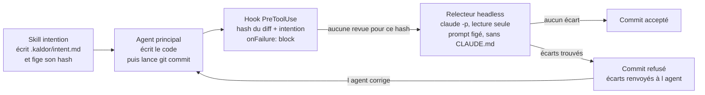
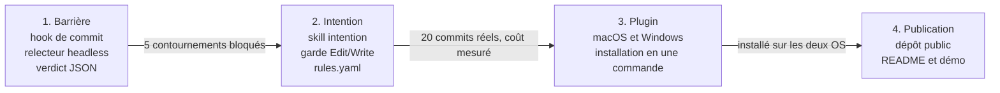

# Kaldor : dossier de projet

17 octobre 2026 · Philippe Matray, Atypical Consulting

## Nom du projet

Nom retenu : **Kaldor** (commande `kaldor`). C'est une marque inventée, sans lien avec la fonction : elle se prononce pareil en français et en anglais, et se démarque dans un créneau saturé de métaphores déjà prises par des outils pour Claude Code (Countersign, Plumbline, Touchstone, Lockkeeper).

| Élément | Valeur |
| --- | --- |
| ID NuGet | `Atypical.Kaldor` |
| Commande | `kaldor` |
| Dossier d'état | `.kaldor/` |
| Site | kaldor.atypical.consulting, servi par GitHub Pages |
| Distribution | Plugin Claude Code et outil .NET sur NuGet, sans npm |
| Licence | MIT |

Vérification par recherche web : aucun produit ni projet logiciel sous ce nom, seulement un pseudonyme d'auteur de modules Perl. À confirmer dans la base de marques de l'EUIPO avant de créer logo et domaine.

## Problème et objectif

Objectif : qu'aucun commit produit par un agent Claude Code n'entre dans le dépôt sans avoir été confronté à une intention déclarée avant le code, par un relecteur que l'agent ne contrôle pas.

- **Le problème** : avec des agents qui codent vite, relire chaque ligne ne tient plus. Mais une revue par le même agent valide son propre raisonnement.
- **L'inspiration** : chez Anthropic, l'outil de revue Antique permet aux humains d'examiner [l'intention d'un changement plutôt que chaque ligne](https://www.anthropic.com/engineering/redesigning-source-control).
- **Le résultat attendu** : tu relis une intention, une liste d'écarts et quelques hunks sensibles, au lieu du diff complet.

Le contexte confirme le besoin : plusieurs auteurs plaident pour [déplacer la revue vers l'intention](https://thenewstack.io/future-of-code-reviews/), et un outil open source comme [no-mistakes](https://docsearch.algolia.com/mcp/docs/repo/kunchenguid/no-mistakes) enchaîne déjà intention puis revue avant un push. Kaldor s'en distingue en se plaçant au commit, à l'intérieur de Claude Code, avec un relecteur isolé du récit de l'agent.

## Principes de conception

1. **L'intention précède le code.** Elle est écrite et figée avant la première modification ; la changer demande ton accord.
2. **Le relecteur ne dépend pas de l'agent.** C'est le hook qui le lance, avec un prompt figé ; il lit l'intention et le diff sur disque.
3. **Le verdict n'est pas un fichier à croire.** Il naît dans le processus du hook et vaut pour un hash précis du diff et de l'intention.
4. **Fermer en cas de doute.** Un hook en panne bloque (`onFailure: "block"`) plutôt que de laisser passer.
5. **L'humain relit l'intention et le sensible.** Le reste est validé et résumé en une ligne.
6. **Le chemin honnête est le plus court.** On vise l'agent pressé, pas l'agent hostile ; inutile de bunkériser une machine locale.

## Périmètre

La version 1 couvre les commits faits par Claude Code dans un dépôt local, sur macOS et Windows.

| Dans le périmètre (v1) | Hors périmètre (v1) |
| --- | --- |
| Commits lancés par Claude Code et ses sous-agents | Commits faits à la main dans un terminal (couvrables plus tard par un hook git) |
| Intention par tâche, figée par hash | Gestion de tickets ou de spécifications complètes |
| Classement des hunks par niveau de risque | Tests, lint, build (restent à la CI) |
| Règles de chemins sensibles par projet | Revue de pull requests sur GitHub ou GitLab |
| Rapport de revue lisible au niveau intention | Interface graphique |
| Installation en plugin Claude Code | Protection contre un agent délibérément hostile |

## Architecture

Cinq composants, tous livrables dans un plugin Claude Code ; le hook est le seul point de passage obligatoire.



| Composant | Forme | Rôle |
| --- | --- | --- |
| Skill intention | Skill Claude Code | Fait rédiger et fige `.kaldor/intent.md` avant le code |
| Garde d'intention | Hook `PreToolUse` sur `Edit\|Write` | Refuse toute modification tant qu'aucune intention n'est figée |
| Garde de commit | Hook `PreToolUse` sur `Bash` (et `PowerShell`) | Détecte un commit, calcule les hash, lance le relecteur, bloque ou laisse passer |
| Relecteur | `claude -p` avec agent en lecture seule | Confronte intention, règles et diff ; rend le verdict JSON |
| Règles | `.kaldor/rules.yaml` | Chemins sensibles, chemins triviaux, critères bloquants, modèle |

## Utilisation au quotidien

Tu installes Kaldor une fois, tu l'actives par dépôt, puis tu travailles avec Claude Code comme d'habitude : Kaldor n'intervient qu'au moment de l'intention et du commit.

**Installation, une fois par machine**

Une seule étape : installer le plugin Kaldor dans Claude Code depuis sa marketplace GitHub. Le plugin apporte les hooks, le skill d'intention et la définition du relecteur. L'outil .NET n'a pas besoin d'être installé : les hooks le lancent via `dnx`, qui le télécharge dans le cache NuGet au premier appel.

```json
{
  "type": "command",
  "command": "dnx",
  "args": ["Atypical.Kaldor@1.0.0", "--yes", "gate"],
  "onFailure": "block",
  "timeout": 900
}
```

Trois choix dans cet extrait de `hooks.json` :

- **Version épinglée** : mettre à jour le plugin met à jour l'outil ; plugin et outil ne peuvent pas diverger.
- **`--yes` obligatoire** : sans lui, le premier lancement attend une confirmation, le hook échoue et `onFailure` bloque tous les commits.
- **Forme exec** (`command` + `args`) : pas de shell intermédiaire, comportement identique sur macOS, Windows et Linux.

Pour tes propres commandes, `dnx Atypical.Kaldor report` fonctionne tel quel. Si tu préfères taper simplement `kaldor`, l'installation globale (`dotnet tool install -g Atypical.Kaldor`) reste une option de confort, pas un prérequis. Une équipe peut aussi épingler la version par dépôt avec un manifeste d'outils local, que `dnx` respecte.

**Activation, une fois par dépôt**

```bash
kaldor init
```

Crée `.kaldor/rules.yaml` avec des règles par défaut (versionnées), et `.kaldor/log/` pour l'historique des revues (ignoré par git).

**Le parcours d'une tâche**

1. Tu demandes une fonctionnalité à Claude.
2. Avant sa première modification, la garde d'intention le bloque tant qu'aucune intention n'est figée. Claude rédige `.kaldor/intent.md` et te la montre.
3. Tu valides ou corriges l'intention en une phrase. Claude la fige avec `kaldor intent freeze`.
4. Claude code, puis lance `git commit`.
5. Le hook calcule les hash et lance le relecteur. Pendant la revue, Claude Code affiche un message d'attente.
6. **Aucun écart** : le commit passe, et le rapport s'ajoute à l'historique.
7. **Écarts trouvés** : le commit est refusé, Claude reçoit la liste des écarts et corrige. S'il estime que l'intention doit évoluer, il propose un amendement, que toi seul peux accepter.
8. En fin de journée ou de tâche, `kaldor report` te montre ce qui mérite ta lecture : intentions, écarts traités, hunks sensibles.

**Quand tu n'es pas d'accord avec le relecteur**

Tu peux forcer le passage d'un commit refusé avec `kaldor approve`, depuis ton propre terminal. Deux verrous réservent cette commande, et `kaldor intent amend --accept`, à un humain : une règle de permission Claude Code qui les refuse à l'agent, et une confirmation interactive exigée par la commande elle-même, à laquelle un appel non interactif de l'agent ne peut pas répondre. Chaque approbation forcée reste tracée dans l'historique.

## Commandes

Huit commandes couvrent la v1 ; au quotidien, tu ne tapes que `kaldor report`, et `kaldor approve` en cas de désaccord.

| Commande | Qui la lance | Rôle |
| --- | --- | --- |
| `kaldor init` | Toi, une fois | Crée `.kaldor/`, les règles par défaut et l'entrée `.gitignore` |
| `kaldor intent freeze` | L'agent | Fige l'intention courante et enregistre son hash |
| `kaldor intent amend` | L'agent propose, toi tu acceptes | Ajoute un amendement daté ; il ne prend effet qu'après ton `--accept` |
| `kaldor gate` | Le hook | Point d'entrée du hook : détecte le commit, calcule les hash, lance le relecteur, rend le verdict |
| `kaldor review` | Toi | Revue à blanc du diff stagé, sans bloquer ; utile pour tester les règles |
| `kaldor report` | Toi | Affiche les dernières revues au niveau intention |
| `kaldor approve` | Toi seul | Force le passage d'un commit refusé, avec trace ; interdite à l'agent |
| `kaldor doctor` | Toi | Vérifie l'installation : hooks présents, version de Claude Code, règle de permission, `onFailure` |

## Exemple de rapport

Ce que t'affiche `kaldor report` après un commit bloqué puis corrigé (format proposé) :

```text
Tâche     Pagination de GET /orders
Intention paramètres page et size, 50 par défaut ;
          ne touche pas au schéma ni à l'authentification

Revue 1   BLOQUÉ
  écart   cache ajouté dans OrdersQuery.cs, non annoncé
  écart   test OrdersAuthTests supprimé
Revue 2   ACCEPTÉ
  à lire  OrdersQuery.cs lignes 40-62 (logique)
  validé  4 fichiers triviaux ou mécaniques

Ton temps de lecture estimé : un hunk au lieu de 6 fichiers
```

## Contrats de fichiers

Trois fichiers dans `.kaldor/` portent tout l'état ; formats proposés, à valider au premier POC.

**Intention** (`.kaldor/intent.md`), écrite avant le code et figée par hash :

```markdown
# Intention
But : ajouter la pagination à l'endpoint GET /orders
Comportement attendu : paramètres page et size, 50 par défaut
Ne doit pas toucher : le schéma de base, l'authentification
Fichiers attendus : OrdersController.cs, OrdersQuery.cs, tests associés
```

**Règles du projet** (`.kaldor/rules.yaml`), versionnées avec le dépôt :

```yaml
sensitive:
  - "src/Auth/**"
  - "**/Migrations/**"
  - "appsettings*.json"
trivial:
  - "**/*.md"
reviewer_model: sonnet
block_on: [scope_creep, sensitive_change, weakened_tests]
```

**Verdict** (sortie JSON du relecteur, jamais écrite par l'agent) :

```json
{
  "diff_hash": "sha256:…",
  "intent_hash": "sha256:…",
  "verdict": "block",
  "deviations": ["Ajout d'un cache non annoncé dans OrdersQuery.cs"],
  "hunks": [{"file": "OrdersQuery.cs", "risk": "logic", "must_read": true}],
  "summary": "Pagination conforme, un ajout hors périmètre"
}
```

## Exigences non fonctionnelles

Cibles proposées pour la v1 ; les chiffres de latence et de coût seront fixés après la mesure sur 20 commits réels.

| Exigence | Cible v1 |
| --- | --- |
| Comportement en panne | Fermeture : tout échec ou timeout du hook bloque le commit |
| Latence d'un commit | Dominée par la revue du modèle ; budget à fixer après mesure, timeout du hook à 900 s |
| Plateformes | macOS, Windows, Linux, grâce à l'outil .NET lancé via dnx en forme exec |
| Prérequis | SDK .NET 10 (pour `dnx`), Claude Code v2.1.295 ou plus récent (`onFailure`), git ; réseau au premier appel, cache NuGet ensuite |
| Confidentialité | Le diff et l'intention partent vers le même fournisseur que la session Claude Code ; aucun service tiers ajouté |
| Traçabilité | Chaque verdict et chaque approbation forcée sont journalisés dans `.kaldor/log/` |
| Compatibilité | Kaldor ne modifie ni git ni le dépôt distant ; désinstaller le plugin rend un Claude Code standard |

## Stack et structure du dépôt

Un seul dépôt GitHub sous licence MIT, en .NET pour le cœur et en fichiers déclaratifs pour le plugin.

```text
kaldor/
  src/
    Kaldor.Cli/        outil .NET exécuté via dnx (commandes, point d'entrée du hook)
    Kaldor.Core/       détection des commits, hash, règles, journal
    Kaldor.Review/     lancement du relecteur headless et lecture du verdict
  plugin/
    .claude-plugin/plugin.json
    hooks/hooks.json   gardes PreToolUse sur Edit|Write et Bash|PowerShell
    agents/            définition du relecteur en lecture seule
    skills/intent/     skill de rédaction de l'intention
  tests/
  docs/                site GitHub Pages (kaldor.atypical.consulting)
```

## Stratégie de test

La valeur de Kaldor tient à sa barrière : les tests prioritaires sont ceux qui essaient de la contourner.

- **Tests unitaires** : détection d'un commit dans toutes les formes de commande (`git -C`, variables en tête, sous-shell, alias), calcul des hash, lecture des règles.
- **Suite de contournement** : les raccourcis du modèle de menace, chacun rejoué en test d'intégration ; un seul qui passe fait échouer la build.
- **Relecteur simulé** : un faux relecteur déterministe pour tester le hook sans appel au modèle ni coût.
- **Jeu de diffs de référence** : des diffs réels annotés (conforme, hors périmètre, sensible), rejoués contre le vrai relecteur à chaque changement de prompt ou de modèle, pour mesurer les faux positifs et les écarts manqués.
- **Kaldor sur Kaldor** : le dépôt est développé avec Kaldor actif dès la fin de la phase 1.

## Modèle de menace et parades

La menace visée est l'agent pressé qui prend un raccourci ; le détail des failles est dans l'[analyse d'architecture](analyse-architecture.md).

| Raccourci possible | Parade |
| --- | --- |
| Cadrer le relecteur en sa faveur | Relecteur lancé par le hook, prompt figé, sans CLAUDE.md |
| Écrire lui-même un verdict favorable | Verdict produit dans le processus du hook, jamais lu depuis un fichier modifiable |
| Réécrire l'intention pour coller au code | Hash de l'intention figé ; un amendement n'a d'effet qu'après ton acceptation |
| Modifier le code après la revue | Verdict lié au hash du diff stagé |
| Contourner la détection (`git -C`, script) | Analyse de la commande dans le script, pas de filtre `if` étroit |
| Profiter d'un hook en panne | `onFailure: "block"` |
| S'auto-approuver ou accepter son propre amendement | Règle de permission en refus et confirmation interactive exigée |

## Feuille de route

La phase 1 seule apporte déjà la barrière ; les suivantes la rendent confortable puis partageable.



Une phase ne démarre que lorsque le critère de la précédente est atteint. Le cœur étant un outil .NET portable, la phase 3 se réduit surtout à l'empaquetage et aux tests sur les deux OS.

## Prochaines étapes

Les trois premières débloquent tout le reste et tiennent en une session de travail avec Claude Code.

- [ ] Vérifier Kaldor dans la base EUIPO, réserver l'ID NuGet Atypical.Kaldor et publier le site GitHub Pages sur kaldor.atypical.consulting
- [ ] Trancher la politique d'amendement de l'intention
- [ ] ~~Créer le dépôt avec ce dossier en README de conception~~ (fait)
- [ ] POC du hook de commit : détection, hash, refus sans revue, `onFailure: "block"`
- [ ] POC du relecteur headless avec sortie JSON conforme au contrat
- [ ] Jeu de tests de contournement (cinq raccourcis du modèle de menace)
- [ ] Essai du hook de type `agent` : accès au diff et latence
- [ ] Mesurer coût et latence sur 20 commits réels, dont le coût de démarrage de dnx sur les commandes Bash filtrées par le hook

## Décisions : qui tranche

Sur six questions, deux seulement sont à toi : la confiance accordée à l'agent et le statut du code. Les autres se tranchent par une mesure, par un principe déjà posé ou par l'architecture.

| Question | Qui tranche | Proposition |
| --- | --- | --- |
| Changement d'intention en cours de tâche | **Toi** | C'est le niveau d'autonomie que tu accordes. Défaut proposé : l'agent peut ajouter une section « Amendements » datée, jamais réécrire ; le relecteur la signale et le rapport la place en tête. |
| Licence et publication | **Toi** | Tranché : licence MIT. Le projet sert de vitrine ; sans revenus de licence, la déduction pour revenus d'innovation ne s'applique pas à Kaldor lui-même. |
| Modèle du relecteur | La mesure | Rejouer les 20 commits de la phase 2 avec deux modèles et garder le moins cher qui détecte les mêmes écarts. En attendant, modèle capable par défaut. |
| Cache des verdicts | Le principe 3 | Pas de cache en v1 : un cache est un fichier de verdict, donc falsifiable. À rouvrir seulement si le coût mesuré pose problème. |
| Plugin ou CLI | L'architecture | Les deux, sans choix à faire : le hook exige un exécutable, qui est déjà une CLI ; le plugin l'appelle via dnx avec une version épinglée. Distribution par NuGet, sans npm. |
| Plateforme du POC | L'architecture | Écrire le cœur en outil .NET, lancé par le hook via dnx en forme exec. Il tourne tel quel sur macOS et Windows, et la question devient un simple détail de test. |

## Sources

- [Redesigning source control at Anthropic](https://www.anthropic.com/engineering/redesigning-source-control)
- [Claude Code : référence des hooks](https://code.claude.com/docs/en/hooks)
- [Claude Code : sous-agents](https://code.claude.com/docs/en/sub-agents)
- [The New Stack : future of code reviews](https://thenewstack.io/future-of-code-reviews/)
- [no-mistakes](https://docsearch.algolia.com/mcp/docs/repo/kunchenguid/no-mistakes)
