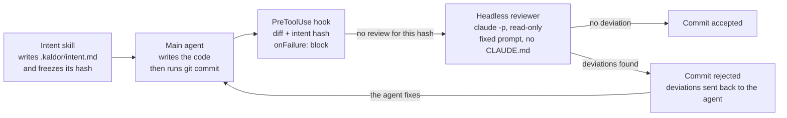
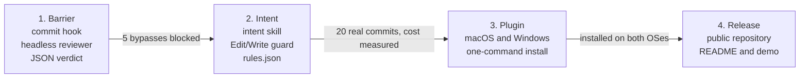

# Kaldor: project dossier

October 17, 2026 · Philippe Matray, Atypical Consulting

**Status: v1 implemented.** This dossier was written before the code; where the implementation differs, the text below has been updated and the differences are listed under [Implementation notes](#implementation-notes).

## Project name

Chosen name: **Kaldor** (command `kaldor`). It is an invented brand, unrelated to the function: it is pronounced the same in French and English, and stands out in a niche crowded with metaphors already taken by Claude Code tools (Countersign, Plumbline, Touchstone, Lockkeeper).

| Item | Value |
| --- | --- |
| NuGet ID | `Atypical.Kaldor` |
| Command | `kaldor` |
| State folders | `.kaldor/` (rules, intent), `.git/kaldor/` (state, history) |
| Site | kaldor.atypical.consulting, served by GitHub Pages |
| Distribution | Claude Code plugin and .NET tool on NuGet, no npm |
| License | MIT |

Web search check: no product or software project under this name, only an author pseudonym for Perl modules. To be confirmed in the EUIPO trademark database before creating a logo and domain.

## Problem and goal

Goal: no commit produced by a Claude Code agent enters the repository without being checked against an intent declared before the code, by a reviewer the agent does not control.

- **The problem**: with agents that code fast, reading every line no longer scales. But a review by the same agent only validates its own reasoning.
- **The inspiration**: at Anthropic, the Antique review tool lets humans examine [the intent of a change rather than every line](https://www.anthropic.com/engineering/redesigning-source-control).
- **The expected outcome**: you read an intent, a list of deviations and a few sensitive hunks, instead of the full diff.

The context confirms the need: several authors argue for [shifting review toward intent](https://thenewstack.io/future-of-code-reviews/), and an open-source tool like [no-mistakes](https://docsearch.algolia.com/mcp/docs/repo/kunchenguid/no-mistakes) already chains intent then review before a push. Kaldor differs by sitting at commit time, inside Claude Code, with a reviewer isolated from the agent's narrative.

## Design principles

1. **Intent comes before code.** It is written and frozen before the first change; changing it requires your approval.
2. **The reviewer does not depend on the agent.** The hook launches it, with a fixed prompt; it reads the intent and the diff from disk.
3. **The verdict is not a file to trust.** It is born inside the hook's process and is valid for a specific hash of the diff and the intent.
4. **Fail closed when in doubt.** A failing hook blocks (`onFailure: "block"`) rather than letting things through.
5. **The human reads the intent and the sensitive parts.** Everything else is validated and summarized in one line.
6. **The honest path is the shortest.** We target the hurried agent, not the hostile one; no need to bunker a local machine.

## Scope

Version 1 covers commits made by Claude Code in a local repository, on macOS and Windows.

| In scope (v1) | Out of scope (v1) |
| --- | --- |
| Commits run by Claude Code and its subagents | Commits made by hand in a terminal (can be covered later by a git hook) |
| Per-task intent, frozen by hash | Ticket management or full specifications |
| Hunks ranked by risk level | Tests, lint, build (left to CI) |
| Per-project sensitive path rules | Pull request review on GitHub or GitLab |
| Review report readable at intent level | Graphical interface |
| Installation as a Claude Code plugin | Protection against a deliberately hostile agent |

## Architecture

Five components, all shipped in a Claude Code plugin plus one .NET tool; the hook is the mandatory checkpoint, with a git `pre-commit` hook as a backstop.



| Component | Form | Role |
| --- | --- | --- |
| Intent skill | Claude Code skill | Has `.kaldor/intent.md` written and frozen before the code |
| Intent guard | `PreToolUse` hook on `Edit\|Write\|MultiEdit\|NotebookEdit` | Rejects any change until an intent is frozen, and any write to `.kaldor/` |
| Commit guard | `PreToolUse` hook on `Bash\|PowerShell` | Detects a commit, computes the hashes, launches the reviewer, blocks or lets through |
| Commit backstop | git `pre-commit` hook, installed by `kaldor init` | Runs the same check for any commit made inside Claude Code (`CLAUDECODE=1`) that the command parser could not see, such as one run from a script |
| Reviewer | `claude -p --safe-mode --tools ""` with a fixed system prompt and `--json-schema` | Checks intent, rules and diff against each other; returns the JSON verdict |
| Rules | `.kaldor/rules.json` | Sensitive paths, trivial paths, blocking criteria, model |

## Day-to-day usage

You install Kaldor once, enable it per repository, then work with Claude Code as usual: Kaldor only steps in at intent time and at commit time.

**Installation, once per machine**

A single step: install the Kaldor plugin in Claude Code from its GitHub marketplace (`/plugin install kaldor --marketplace Atypical-Consulting/kaldor`). The plugin brings the hooks, the intent skill and a `kaldor` launcher on the agent's PATH. The .NET tool does not need to be installed: the hooks launch it via `dnx`, which downloads it into the NuGet cache on first call.

```json
{
  "type": "command",
  "command": "dnx",
  "args": ["--yes", "--version", "1.0.0", "Atypical.Kaldor", "gate"],
  "onFailure": "block",
  "timeout": 900
}
```

Three choices in this `hooks.json` excerpt:

- **Pinned version**: updating the plugin updates the tool; plugin and tool cannot drift apart. The version is its own array element so release-please can stamp it.
- **`--yes` is mandatory**: without it, the first run waits for a confirmation, the hook fails and `onFailure` blocks every commit.
- **Exec form** (`command` + `args`): no intermediate shell, identical behavior on macOS, Windows and Linux.

For your own commands, `dnx Atypical.Kaldor report` works as is. If you prefer to just type `kaldor`, a global install (`dotnet tool install -g Atypical.Kaldor`) remains a convenience option, not a prerequisite. A team can also pin the version per repository with a local tool manifest, which `dnx` honors.

**Activation, once per repository**

```bash
kaldor init
```

Creates `.kaldor/rules.json` with default rules (versioned), a `.kaldor/.gitignore` that keeps everything else local, and the git `pre-commit` backstop. Commit `.kaldor/` yourself, from your own terminal: Kaldor refuses the agent's commits until a task intent is frozen and confirmed, so enabling Kaldor and changing the rules stay your decision.

**The flow of a task**

1. You ask Claude for a feature.
2. Before its first change, the intent guard blocks it until an intent is frozen. Claude writes `.kaldor/intent.md` and shows it to you.
3. You approve or correct the intent in one sentence. Claude freezes it with `kaldor intent freeze`, and you confirm it with `kaldor intent confirm` in your terminal; commits wait for that confirmation.
4. Claude codes, then runs `git commit`.
5. The hook computes the hashes and launches the reviewer. During the review, Claude Code shows a waiting message.
6. **No deviation**: the commit goes through, and the report is added to the history.
7. **Deviations found**: the commit is rejected, Claude receives the list of deviations and fixes them. If it believes the intent should evolve, it proposes an amendment, which only you can accept.
8. At the end of the day or the task, `kaldor report` shows you what deserves your reading: intents, handled deviations, sensitive hunks.

**When you disagree with the reviewer**

You can force a rejected commit through with `kaldor approve`, from your own terminal. Two locks reserve this command, and `kaldor intent amend --accept`, for a human: the gate refuses any agent command line that runs them, and the command itself requires an interactive confirmation, which a non-interactive call from the agent cannot answer. Every forced approval is recorded in the history.

## Commands

Nine commands cover v1; day to day, you only type `kaldor report`, and `kaldor approve` when you disagree.

| Command | Who runs it | Role |
| --- | --- | --- |
| `kaldor init` | You, once | Creates `.kaldor/`, the default rules and the `.gitignore` entry |
| `kaldor intent freeze` | The agent | Freezes the current intent and records its hash |
| `kaldor intent wait` | The agent | Waits, read-only, until you have confirmed the intent, so you never have to report it |
| `kaldor intent confirm` | You only | Confirms the frozen intent; until then the agent's commits are refused |
| `kaldor intent amend` | The agent proposes, you accept | Adds a dated amendment; it only takes effect after your `--accept` |
| `kaldor gate` | The hook | Hook entry point: detects the commit, computes the hashes, launches the reviewer, returns the verdict |
| `kaldor check` | The git `pre-commit` hook | Same check on the index being committed, for agent commits the gate could not see |
| `kaldor review` | You | Dry-run review of the staged diff, non-blocking; useful for testing the rules |
| `kaldor report` | You | Shows the latest reviews at intent level |
| `kaldor approve` | You only | Forces a rejected commit through, with a trace; forbidden to the agent |
| `kaldor doctor` | You | Checks the installation: git, Claude Code version, plugin, rules, pre-commit hook |

## Sample report

What `kaldor report` shows you after a commit was blocked then fixed (proposed format):

```text
Task      Pagination for GET /orders
Intent    page and size parameters, 50 by default;
          does not touch the schema or authentication

Review 1  BLOCKED
  deviation  cache added in OrdersQuery.cs, not announced
  deviation  test OrdersAuthTests deleted
Review 2  ACCEPTED
  to read    OrdersQuery.cs lines 40-62 (logic)
  validated  4 trivial or mechanical files

Your estimated reading time: one hunk instead of 6 files
```

## File contracts

The rules and the intent sit in `.kaldor/`; the state and the history sit in the git common directory, `.git/kaldor/` for the main worktree and `.git/kaldor/worktrees/<id>/` for a linked one, so `git clean` and `git worktree remove` keep them.

**Intent** (`.kaldor/intent.md`), written before the code and frozen by hash:

```markdown
# Intent
Goal: add pagination to the GET /orders endpoint
Expected behavior: page and size parameters, 50 by default
Must not touch: the database schema, authentication
Expected files: OrdersController.cs, OrdersQuery.cs, related tests
```

**Project rules** (`.kaldor/rules.json`), versioned with the repository. JSON rather than YAML so the tool needs no dependency; comments and trailing commas are accepted:

```json
{
  "sensitive": ["**/Auth/**", "**/Migrations/**", "**/appsettings*.json", ".github/**"],
  "trivial": ["**/*.md"],
  "reviewer_model": "sonnet",
  "block_on": ["scope_creep", "sensitive_change", "weakened_tests", "contradicts_intent"]
}
```

**Unattended mode.** `"confirm": "after"` in `rules.json` (default `"before"`; `kaldor doctor` rejects other values) lets commits on a frozen but unconfirmed intent go to the reviewer. The review still applies in full; only the human check of the intent is deferred. Such reviews are logged with `unconfirmed: true`, shown as `UNCONFIRMED` by `kaldor report`, and listed alone by `kaldor report --unconfirmed`. Only the user can set it: the gate applies the rules committed at `HEAD` (the work-tree file only until the setup is first committed), and a commit that changes anything in `.kaldor/` is refused until the user runs `kaldor approve`. `kaldor doctor` warns when the work-tree `rules.json` differs from `HEAD`. A change committed on a branch applies once that branch is checked out. Threat model: the "Freezing an intent you never saw" defence does not hold in this mode by design. The reviewer still checks every diff against the frozen intent, but nobody vouched for the intent beforehand.

**State** (`.git/kaldor/state.json`, local): the frozen intent hash and the (diff hash, intent hash) pairs that passed review or were approved. Reviews and approvals are logged one file each in `.git/kaldor/log/`. Kaldor 1.0 kept both in `.kaldor/`; they move on first use.

**Verdict** (the reviewer's JSON output, never written by the agent):

```json
{
  "diff_hash": "sha256:…",
  "intent_hash": "sha256:…",
  "verdict": "block",
  "deviations": ["Unannounced cache added in OrdersQuery.cs"],
  "hunks": [{"file": "OrdersQuery.cs", "risk": "logic", "must_read": true}],
  "summary": "Pagination as intended, one out-of-scope addition"
}
```

## Non-functional requirements

Proposed targets for v1; latency and cost figures will be set after measuring 20 real commits.

| Requirement | v1 target |
| --- | --- |
| Failure behavior | Fail closed: any hook failure or timeout blocks the commit |
| Commit latency | Dominated by the model review; budget to be set after measurement, hook timeout at 900 s |
| Platforms | macOS, Windows, Linux, thanks to the .NET tool launched via dnx in exec form |
| Prerequisites | .NET 10 SDK (for `dnx`), Claude Code v2.1.295 or later (`onFailure`), git; network on first call, NuGet cache afterwards |
| Privacy | The diff and the intent go to the same provider as the Claude Code session; no third-party service added |
| Traceability | Every verdict and every forced approval is logged in `.git/kaldor/log/` |
| Compatibility | Kaldor modifies neither git nor the remote repository; uninstalling the plugin restores a standard Claude Code |

## Stack and repository layout

A single GitHub repository under the MIT license, .NET for the core and declarative files for the plugin.

```text
kaldor/
  src/Kaldor/          .NET tool run via dnx: commands, gate, command parser, reviewer launch
  tests/Kaldor.Tests/  parser tests and the bypass suite
  plugin/
    .claude-plugin/plugin.json
    hooks/hooks.json   one PreToolUse hook on Edit|Write|MultiEdit|NotebookEdit|Bash|PowerShell
    bin/               `kaldor` launchers (sh and cmd) put on the agent's PATH
    skills/intent/     intent-writing skill
  .claude-plugin/marketplace.json
  docs/
```

One project rather than three: the tool is a few hundred lines, and the reviewer needs no agent file because its prompt is passed with `--system-prompt`.

## Test strategy

Kaldor's value lies in its barrier: the priority tests are the ones that try to bypass it.

- **Unit tests**: commit detection in every command form (`git -C`, leading variables, subshell, alias), hash computation, rule parsing.
- **Bypass suite**: the shortcuts from the threat model, each replayed as an integration test; a single one getting through fails the build.
- **Simulated reviewer**: a deterministic fake reviewer to test the hook without model calls or cost.
- **Reference diff set**: annotated real diffs (compliant, out of scope, sensitive), replayed against the real reviewer on every prompt or model change, to measure false positives and missed deviations.
- **Kaldor on Kaldor**: the repository is developed with Kaldor active from the end of phase 1.

## Threat model and countermeasures

The targeted threat is the hurried agent taking a shortcut; the flaws are detailed in the [architecture analysis](architecture-analysis.md).

| Possible shortcut | Countermeasure |
| --- | --- |
| Framing the reviewer in its favor | Reviewer launched by the hook, fixed prompt, no CLAUDE.md |
| Writing a favorable verdict itself | Verdict produced inside the hook's process, never read from a modifiable file |
| Rewriting the intent to match the code | Intent hash frozen; an amendment only takes effect after your acceptance |
| Changing the code after the review | Verdict bound to the hash of the staged diff |
| Bypassing detection (`git -C`, script) | Command parsing in the script, no narrow `if` filter |
| Exploiting a failing hook | `onFailure: "block"` |
| Self-approving or accepting its own amendment | Gate refusal of the command and required interactive confirmation |

## Roadmap

Phase 1 alone already delivers the barrier; the following ones make it comfortable, then shareable.



A phase only starts once the previous one's criterion is met. Since the core is a portable .NET tool, phase 3 mostly comes down to packaging and testing on both OSes.

## Next steps

The first three unblock everything else and fit in one working session with Claude Code.

- [ ] Check Kaldor in the EUIPO database, reserve the Atypical.Kaldor NuGet ID and publish the GitHub Pages site at kaldor.atypical.consulting
- [x] Settle the intent amendment policy: dated amendments, accepted by the human only
- [x] Create the repository with this dossier as the design README
- [x] Commit hook: detection, hashes, rejection without review, `onFailure: "block"`
- [x] Headless reviewer with JSON output matching the contract
- [x] Bypass test suite (the shortcuts from the threat model)
- [ ] Try the `agent`-type hook: diff access and latency
- [ ] Measure cost and latency on 20 real commits (first measures: dnx startup about 0.5 s per tool call; one review 4 to 5 s with Sonnet on a small diff)

## Decisions: who decides

Of six questions, only two are yours: the trust given to the agent and the code's status. The others are settled by a measurement, by an existing principle or by the architecture.

| Question | Who decides | Proposal |
| --- | --- | --- |
| Changing the intent mid-task | **You** | This is the level of autonomy you grant. Proposed default: the agent may add a dated "Amendments" section, never rewrite; the reviewer flags it and the report puts it first. |
| License and publication | **You** | Decided: MIT license. The project serves as a showcase; without license income, the innovation income deduction does not apply to Kaldor itself. |
| Reviewer model | Measurement | Replay the 20 commits from phase 2 with two models and keep the cheapest one that detects the same deviations. Meanwhile, a capable model by default. |
| Verdict cache | Principle 3 | No cache in v1: a cache is a verdict file, hence forgeable. To be reopened only if the measured cost becomes a problem. |
| Plugin or CLI | Architecture | Both, no choice needed: the hook requires an executable, which is already a CLI; the plugin calls it via dnx with a pinned version. Distributed through NuGet, no npm. |
| POC platform | Architecture | Write the core as a .NET tool, launched by the hook via dnx in exec form. It runs as is on macOS and Windows, and the question becomes a mere testing detail. |

## Implementation notes

What v1 does differently from the plan above, and why:

- **Rules in JSON, not YAML**: no parser dependency for a file of four keys.
- **No reviewer agent file**: the reviewer is `claude -p --safe-mode --tools "" --no-session-persistence` with the system prompt and a JSON schema passed on the command line. `--safe-mode` disables CLAUDE.md, plugins and hooks while keeping the user's authentication, so the reviewer reads nothing the agent could have written, and cannot recurse into Kaldor. It has no tools: the diff is sent with five lines of context.
- **A git `pre-commit` backstop**: the command parser covers `git -C`, `cd x &&`, wrappers, subshells, `bash -c` and aliases, but cannot see inside a script. `kaldor init` installs a `pre-commit` hook that runs the same check whenever `CLAUDECODE=1`, so a commit from a script is reviewed too. Human commits are not affected.
- **Blocked verdicts are reused**: the same diff against the same intent gets the same answer without a second model call. Passing verdicts are kept in `state.json` so the backstop does not review twice.
- **Starting a new intent**: `kaldor intent freeze` replaces a frozen intent only when the work tree is clean. Mid-task, the intent can change only through an amendment the human accepts. An agent that stashes its work can freeze a new intent, but its commits then wait for the human's `kaldor intent confirm`.
- **Cost of the gate**: every Bash and edit tool call starts the tool through dnx, about 0.5 s. Narrowing the hook with `if` would reopen the bypasses it exists to close.

## Sources

- [Redesigning source control at Anthropic](https://www.anthropic.com/engineering/redesigning-source-control)
- [Claude Code: hooks reference](https://code.claude.com/docs/en/hooks)
- [Claude Code: subagents](https://code.claude.com/docs/en/sub-agents)
- [The New Stack: future of code reviews](https://thenewstack.io/future-of-code-reviews/)
- [no-mistakes](https://docsearch.algolia.com/mcp/docs/repo/kunchenguid/no-mistakes)
